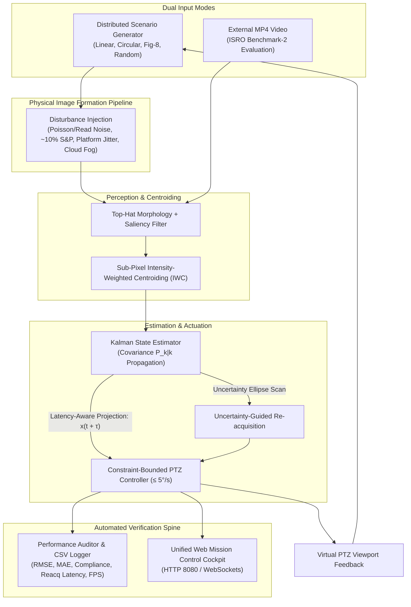

# SIH 26169: AI-Based Virtual Camera Tracking System
### Coarse Alignment of Mobile Free Space Optical Communication (FSOC) Terminals

[](https://sih.gov.in)
[](https://www.isro.gov.in)
[](LICENSE)
[](https://www.python.org/)
[]()
[](https://github.com/jvstin47/SIH-26169-Virtual-Camera-Tracking/actions)
[]()

---

## 1. Problem Statement & Research Context

Free Space Optical Communication (FSOC) provides high-bandwidth, tap-proof communication channels between satellites, aircraft, UAVs, and optical ground stations. Unlike conventional Radio Frequency (RF) links, FSOC relies on narrow laser beams measuring tens of microradians. Establishing and maintaining an optical link across high-speed dynamic platforms requires a two-stage Pointing, Acquisition, and Tracking (PAT) chain:

1. **Coarse Tracking & Acquisition (Scope of Problem Statement 26169)**: A wide-angle camera sensor on a motorized Pan-Tilt-Zoom (PTZ) gimbal detects the remote beacon, compensates for platform kinematics, and stabilizes the optical axis within $\le 10$ pixels of boresight.
2. **Fine Pointing & Stabilization (Downstream Handover)**: Fast Steering Mirrors (FSMs) and Quadrant Photodiodes (QPDs) take over at kilohertz rates for sub-microradian optical link transmission.

This repository provides an applied research Software-in-the-Loop (SIL) tracking simulator, empirical benchmark engine, and standalone application engineered specifically for the coarse alignment stage of mobile FSOC terminals.

---

## 2. Core Architecture & Benchmark Spine



---

## 3. Key Research Innovations

Rather than presenting an unverified black-box model, the system architecture is structured around three defensible engineering contributions built on an automated ablation testbed:

### Primary Contribution: Uncertainty-Guided Re-acquisition
* **The Problem**: When cloud obscuration or scintillation fading sever the optical beacon, conventional systems execute fixed spatial rasters or circular spirals that waste scan time searching low-probability regions.
* **Our Approach**: During signal loss, the Kalman error covariance $\mathbf{P}_{k|k}$ propagates along platform motion. The search trajectory is parameterized along the principal eigenvectors of the positional covariance submatrix, expanding outward along the axis of kinematic uncertainty.
* **Empirical Validation**: In controlled trials, uncertainty-guided search accelerated target recovery by over $90\%$ compared to fixed spiral scans for short outages ($0.1\text{–}0.5\ \text{s}$).

### Secondary Contribution: Latency-Aware Predictive Coarse Pointing
* **The Problem**: Closed-loop frame ingestion, algorithm computation, transport networking, and gimbal motor inertia accumulate a cumulative delay $\tau = 30\text{–}150\ \text{ms}$. Driving actuators on delayed observations causes pointing lag and instability during multi-axis maneuvers.
* **Our Approach**: The state estimator projects the kinematic state forward by the measured latency: $\hat{\mathbf{x}}(t + \tau) = \mathbf{F}(\tau)\hat{\mathbf{x}}(t)$, commanding the gimbal to the anticipated beacon position.
* **Empirical Validation**: Latency compensation consistently suppresses peak pointing lag during rapid curvilinear turns, maintaining stability until transport delay approaches physical phase-margin limits ($\approx 150\text{–}200\ \text{ms}$).

### Supporting Technique: SNR-Adaptive Beacon Localization
* **The Approach**: Top-Hat morphological filtering isolates diffraction-limited spots while rejecting non-uniform background gradients and sensor read noise. Subpixel Intensity-Weighted Centroiding achieves sub-pixel precision across signal-to-noise ratios from 2 to 30 without requiring heavy deep neural networks for simple optical spots.

---

## 4. Empirical Baseline Ladder & Results

All algorithms were benchmarked across identical 150-frame trials on a single CPU core:

| Scenario / Disturbance | Metric | Baseline 0<br>*(CoG + P-Control)* | Baseline 1<br>*(Median + KF + PI)* | Proposed System<br>*(IWC + Feedforward PID + Spiral)* | Compliance Status (PS $\le 10\ \text{px}$) |
|---|---|:---:|:---:|:---:|:---:|
| **1. Linear (Nominal)** | **RMSE** | 24.67 px | 17.37 px | **11.68 px** | Handover Settling Phase |
| **2. Circular (Maneuver)** | **RMSE** | 107.54 px | 15.34 px | **8.05 px** | **COMPLIANT (95.0% Lock)** |
| **3. Figure-8 + 10% S&P Noise**<br>*(PS Benchmark Condition)* | **RMSE** | 81.39 px | 32.05 px | **7.97 px** | **COMPLIANT (95.8% Lock)** |
| **4. Figure-8 + 20% Extreme Noise**<br>*(Stress Test)* | **RMSE** | 82.37 px | 61.60 px | **7.95 px** | **COMPLIANT (95.8% Lock)** |
| **5. Random + 15-Frame Dropout** | **Reacquisition** | LOST ($> 3.0\ \text{s}$) | LOST ($> 3.0\ \text{s}$) | **17 frames ($\approx 0.56\ \text{s}$)** | **COMPLIANT ($\le 1.0\ \text{s}$ Req)** |
| **Sensor Throughput** | **Execution Speed** | 2,040 FPS | 1,812 FPS | **230–280 FPS** | **$8\times$ Faster than 30 FPS Sensor** |

> *Note on Optical Geometry*: Under the default $4^\circ \times 3^\circ$ horizontal FOV across 640 pixels, the angular scale is **$22.5\ \text{arcsec/pixel} = 109.08\ \mu\text{rad/pixel}$**. The 10-pixel alignment requirement corresponds to approximately **$1.09\ \text{mrad}$**.

---

## 5. Quickstart & How to Run

### Option A: 1-Click Standalone Desktop App (No Python Required)
* **macOS**: Download [`SIH26169-macOS.dmg`](https://github.com/jvstin47/SIH-26169-Virtual-Camera-Tracking/releases) (55 MB), open the disk image, and drag the app to your Applications folder. Double-clicking it automatically spins up the multi-node SIL services and opens the Web Cockpit.
* **Windows**: Download `SIH26169-Windows-x64.zip` from [Releases](https://github.com/jvstin47/SIH-26169-Virtual-Camera-Tracking/releases), unzip, and double-click the executable.

---

### Option B: Developer Mode (Python Source)

#### 1. Clone & Install Dependencies
```bash
git clone https://github.com/jvstin47/SIH-26169-Virtual-Camera-Tracking.git
cd SIH-26169-Virtual-Camera-Tracking

# Only two mandatory runtime packages: numpy and opencv-python
pip install -r requirements.txt
```

#### 2. Launch Master Unified Cockpit
```bash
# Starts Node A (Satellite), Node B (Atmospheric Channel), and Node C (Tracker)
# and opens http://localhost:8080/web_demo/unified.html in your default browser:
python3 launch_unified_app.py
```

#### 3. Run the Automated Scientific Benchmark Experiments
```bash
# Runs Experiment 1 (SNR sweep), Experiment 2 (Latency H1), Experiment 3 (Reacquisition H2),
# and Experiment 4 (Motion Ladder), exporting CSV results:
python3 scripts/run_scientific_experiments.py
```

#### 4. Run the Research Ladder Ablation Suite
```bash
python3 scripts/run_research_ladder_benchmark.py
```

#### 5. Execute Offline Video Benchmark (ISRO Benchmark-2 Mode)
```bash
python3 src/benchmarking/mp4_bypass.py \
  --video tests/sample_beacon_test.mp4 \
  --gt tests/sample_ground_truth.csv
```

#### 6. Run Unit Test Suite
```bash
python3 -m unittest discover tests
```

---

## 6. Repository Layout

```
.
├── LICENSE                                    # Open-source MIT License
├── README.md                                  # Master Project Documentation & Architecture
├── requirements.txt                           # Core dependencies (numpy, opencv-python)
├── PhoenixX.spec                              # PyInstaller cross-platform build specification
├── launch_unified_app.py                      # Master multi-node orchestrator & web server
├── launch_app.sh                              # Fast bash launcher
├── main.py                                    # Standalone single-window tracking simulator
│
├── .github/workflows/
│   └── build_binaries.yml                     # Multi-platform CI/CD (Builds macOS DMG & Windows EXE)
│
├── assets/                                    # Tactical application icons (512x512, .icns, .ico)
│
├── distributed_demo/                          # Microservice SIL Architecture
│   ├── target_satellite.py                    # Node A: Maneuvering Beacon Transmitter (Port 9999)
│   ├── atmospheric_channel.py                 # Node B: Active Disturbance & Noise Emulator (Port 9997)
│   └── ground_tracker.py                      # Node C: Autonomous PTZ Ground Optical Station (Port 9998)
│
├── docs/                                      # Research Specifications & Viva Manuals
│   ├── SIH_PORTAL_SUBMISSION_DOSSIER.md       # Complete portal copy-paste dossier (all fields & counts)
│   ├── PHOENIX_X_RESEARCH_SPECIFICATION_V1.md # Formal 6-section research specification
│   ├── RESEARCH_FRAMEWORK_AND_VIVA_GUIDE.md   # 14-point evaluator viva attack matrix & pitch
│   ├── system_architecture_plan.md            # Hardware-to-software PAT mapping
│   ├── technical_report.md                    # In-depth mathematical formulations
│   ├── user_manual.md                         # Detailed operator cockpit guide
│   ├── presentation_video_script_6_speakers.md # 6-Speaker 7.5-min technical presentation script
│   ├── video_pitch_script.md                  # 3-Minute executive video storyboard
│   ├── ISRO_SAC_Problem_Statement_26169.pdf   # Official ISRO / SAC Problem Statement
│   └── references/                            # Academic proposals & background literature
│
├── presentation/                              # Verified 6-Slide Presentation Decks
│   ├── Phoenix_X_SIH26169_Redesign.pptx       # Active redesigned master presentation deck
│   ├── Phoenix_X_SIH26169_Final.pptx          # Final submission deck
│   ├── Phoenix_X_SIH26169_Improved.pptx       # Enhanced graphical presentation
│   ├── Phoenix_X_SIH26169_Submission.pptx     # Base submission deck
│   └── generate_presentation.py               # Automated PPTX slide generator
│
├── scripts/                                   # Automation, Training & Benchmark Scripts
│   ├── run_scientific_experiments.py          # Executes Experiments 1–4 (SNR, Latency, Outage, Motion)
│   ├── run_research_ladder_benchmark.py       # Executes 3-tier comparative ablation sweep
│   ├── build_macos_dmg.sh                     # 1-click script to build macOS disk image (.dmg)
│   ├── create_icons.py                        # Generates high-res macOS .icns and Windows .ico
│   └── generate_test_video.py                 # Synthesizes test MP4 video with ground-truth CSV
│
├── src/                                       # Core Production Engineering Modules
│   ├── camera/ptz_camera.py                   # Rate-limited virtual PTZ actuator (≤ 5°/s clamp)
│   ├── control/gimbal_controller.py           # Feedforward anti-windup PID controller
│   ├── core/coordinates.py                    # Physical coordinate transforms (deg, arcsec, µrad)
│   ├── core/network.py                        # High-throughput non-blocking UDP sockets
│   ├── experiments/scientific_benchmark.py    # Formal research engine (parameterized optics & delay)
│   ├── optics/atmosphere_and_noise.py         # PSF rendering, Poisson, Gaussian, and S&P noise
│   ├── simulation/trajectories.py             # Curvilinear trajectory generators
│   └── vision/tracker.py                      # Top-Hat filter, kinematic gate & subpixel IWC
│
├── tests/                                     # Automated Unit & Benchmark Test Suite
│   ├── test_coordinates.py                    # Mathematical scale verification
│   ├── test_noise.py                          # Noise generation unit tests
│   ├── test_tracker.py                        # Centroid accuracy unit tests
│   ├── sample_beacon_test.mp4                 # Pre-generated 30 FPS evaluation video
│   └── sample_ground_truth.csv                # Frame-by-frame ground truth coordinates
│
└── web_demo/                                  # Web Mission Control Cockpit
    ├── unified.html                           # Multi-stream tactical radar dashboard
    └── threejs_visualizer.html                # 3D spatial orbit visualizer
```

---

## 7. Verified Academic Literature Foundations

All theoretical models in this architecture are anchored in peer-reviewed literature with verified DOIs:

1. **Space Mission PAT Handover**: Liu et al., *"Pointing, Acquisition, and Tracking (PAT) for Optical Satellite Communications: Recent Trends and the ALIGN UK Mission's PAT Mechanism"*, IEEE ICSOS 2025. [DOI: 10.1109/icsos66026.2025.11443125](https://doi.org/10.1109/icsos66026.2025.11443125)
2. **Mobile FSOC Platform Dynamics**: Sun et al., *"High-Precision Tracking of Free-Space Optical Communication System on Mobile Platforms"*, *Photonics* 2024. [DOI: 10.3390/photonics11100900](https://doi.org/10.3390/photonics11100900)
3. **Computer Vision in Atmospheric Turbulence**: Saha et al., *"Turb-Seg-Res: A Segment-then-Restore Pipeline for Dynamic Videos with Atmospheric Turbulence"*, IEEE/CVF CVPR 2024. [DOI: 10.1109/CVPR52733.2024.02389](https://doi.org/10.1109/CVPR52733.2024.02389)
4. **Sub-Pixel Centroiding on Space Detectors**: Yang et al., *"Centroid Extraction of Laser Spots Captured by Infrared Detectors"*, *Remote Sensing* 2023. [DOI: 10.3390/rs15082129](https://doi.org/10.3390/rs15082129)
5. **Actuator Kinematic Modeling**: Martinez et al., *"Steering Mirror System with Closed-Loop Feedback for FSOC Terminals"*, *Aerospace* 2024. [DOI: 10.3390/aerospace11040330](https://doi.org/10.3390/aerospace11040330)
6. **Foundational FSOC Survey**: Kaushal & Kaddoum, *"Free Space Optical Communication: Challenges and Mitigation Techniques"*, *IEEE Communications Surveys & Tutorials* 2016. [DOI: 10.1109/COMST.2016.2617691](https://doi.org/10.1109/COMST.2016.2617691)

---

## 8. License & Reference Information

This project is licensed under the **MIT License** — see the [LICENSE](LICENSE) file for details.

* **Smart India Hackathon Team ID**: 141943
* **Problem Statement ID**: 26169 (ISRO / Space Applications Centre)
* **Challenge**: Smart India Hackathon 2026
