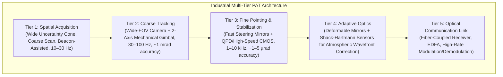

# Phoenix-X: Research Specification v1.0
**Target**: Smart India Hackathon 2026 — Problem Statement ID 26169 (ISRO / SAC)  
**Project**: AI-Based Virtual Camera Tracking System for Coarse Alignment of Mobile FSOC Terminals  
**Research Framework**: Scientific Hierarchy, System Boundaries, and Benchmark Specification  

---

## 1. What Real Operational PAT Systems Do

In space and airborne Free-Space Optical Communications (FSOC), establishing and maintaining a multi-gigabit laser link between moving platforms requires a hierarchical Pointing, Acquisition, and Tracking (PAT) system (as established across NASA LCRD/ILLUMA-T, ESA PATROL, EDRS, and JAXA OICETS):



1. **Spatial Acquisition**: Initial geometric uncertainty cones between platforms range from 1 to 10 milliradians. An acquisition beacon (wide divergence laser or optical transmitter) is scanned across the uncertainty volume until detected.
2. **Coarse Tracking**: A wide-FOV optical sensor (focal plane array) tracks the beacon centroid, driving a 2-axis mechanical gimbal (pan/tilt) to stabilize the optical axis within the capture range of the fine-pointing stage (typically $< 1\ \text{mrad}$).
3. **Fine Pointing & Micro-Jitter Rejection**: Fast Steering Mirrors (FSMs) operating between 1 kHz and 10 kHz counteract platform micro-jitter (reaction wheels, thruster firing, aerodynamic flutter) to achieve sub-microradian precision.
4. **Point-Ahead Angle (PAA)**: Compensates for relativistic line-of-sight displacement during signal transit across thousands of kilometers.
5. **Adaptive Optics**: Corrects dynamic phase distortions caused by atmospheric index-of-refraction turbulence ($C_n^2$).

---

## 2. What SIH Problem Statement 26169 Actually Requires

Problem Statement 26169 from ISRO Space Applications Centre (SAC) does **not** ask for a physical spaceflight terminal. It specifically requests:
> *"Development of an AI-Based Virtual Camera Tracking System for Coarse Alignment of Mobile Free Space Optical Communication (FSOC) Terminals."*

### Explicit Technical Boundaries & Requirements in PS 26169:
| Parameter | Specified Value in PS 26169 | Engineering Meaning |
|---|---|---|
| **Sensor Resolution** | $640 \times 480$, 8-bit Monochromatic | Coarse Focal Plane Array (FPA) viewport |
| **Sensor Field of View (FOV)** | $4^\circ \times 3^\circ$ (horizontal $\times$ vertical) | Wide-angle coarse acquisition cone |
| **Angular Pixel Scale** | $4^\circ / 640\ \text{px} = 22.5\ \text{arcsec/px} = 109.08\ \mu\text{rad/px}$ | Instantaneous Field of View (IFOV) |
| **Coarse Alignment SLA** | **$\le 10$ pixels of optical boresight** | $10\ \text{px} = 225\ \text{arcsec} \approx 1.09\ \text{mrad}$ coarse handover boundary |
| **Actuator Slew Limits** | **5 to 10 deg/sec** (default: **5 deg/sec**) | Mechanical gimbal motor rate saturation constraint |
| **Disturbance Profiles** | 10% Salt & Pepper noise, turbulence shimmer, fog attenuation, $\pm 20$ px platform jitter | Controlled operational disturbance envelope |
| **Target Trajectories** | Straight line, circular, figure-8 (lemniscate), random walk | Multi-axis platform motion classes |
| **Re-acquisition Requirement** | Re-establish tracking lock in **$\le 1.0$ second** | Recovery after signal obstruction / blackout |
| **Evaluation Mode** | Run on both interactive simulator and offline MP4 video | Must operate open-loop on uninstrumented video |

---

## 3. What Phoenix-X Will Model (The Research Core)

Phoenix-X focuses strictly on **Tier 2: Coarse Tracking and Re-acquisition under Closed-Loop Latency**:


### The 3 Core Research Innovations:

### Innovation 1: Latency-Compensated Predictive Pointing
In physical optical tracking, closed-loop latency degrades stability far more than detection accuracy:
$$\tau_{\text{total}} = \tau_{\text{exposure}} + \tau_{\text{readout}} + \tau_{\text{algorithm}} + \tau_{\text{transport}} + \tau_{\text{actuator}}$$
At 30 FPS, frame exposure and processing consume $\approx 33\ \text{ms}$, while mechanical actuator inertia adds 20–50 ms. Commanding the gimbal based on the *measured* centroid at $t$ introduces pointing lag.
* **Our Approach**: The state estimator projects the kinematic state forward by the measured system latency:
  $$\hat{\mathbf{x}}(t + \tau_{\text{total}}) = \mathbf{F}(\tau_{\text{total}}) \hat{\mathbf{x}}(t)$$
* **Experimental Proof**: Measure tracking RMSE as synthetic transport latency is swept from $0\ \text{ms} \to 150\ \text{ms}$ (comparing No Prediction vs. Standard Kalman vs. Latency-Compensated Kalman).

### Innovation 2: Uncertainty-Guided Re-acquisition
When an optical link is severed by clouds or severe scintillation fading, deterministic scans (fixed spirals or raster searches) waste time sweeping low-probability regions.
* **Our Approach**: During signal loss, the state covariance $\mathbf{P}_{k|k}$ propagates outward according to the process noise $\mathbf{Q}$:
  $$\mathbf{P}_{k+1|k} = \mathbf{F} \mathbf{P}_{k|k} \mathbf{F}^T + \mathbf{Q}$$
  The spatial search trajectory is parameterized directly by the eigenvalues $\lambda_1, \lambda_2$ and eigenvectors of the position uncertainty submatrix, expanding along the principal axis of kinematic uncertainty.
* **Experimental Proof**: Measure re-acquisition latency ($T_{\text{reacq}}$) across 100 Monte Carlo blackout trials comparing:
  1. Static Hold (freeze camera)
  2. Fixed Raster Scan
  3. Fixed Archimedean Spiral
  4. **Uncertainty-Guided Adaptive Scan**

### Innovation 3: SNR-Adaptive Beacon Localization
Rather than deploying an unneeded heavy deep learning network for simple spots, the perception pipeline uses classical matched spatial filtering, bringing in machine learning **only** when classical hypothesis testing encounters ambiguous candidates (stars, sun reflections, multi-point clutter):
1. Background suppression via morphological Top-Hat transform.
2. Candidate proposal with dynamic local signal-to-noise ratio estimation:
   $$\text{SNR}_{\text{local}} = \frac{I_{\text{peak}} - \mu_{\text{bg}}}{\sigma_{\text{bg}}}$$
3. Subpixel localization using 2D intensity-weighted centroiding on validated candidates.
4. Tiny ML discriminator ($< 10\ \text{KB}$) activated only during multi-peak ambiguity.

---

## 4. What Phoenix-X Deliberately Will NOT Model (Scope Shield)

To maintain absolute scientific credibility during the ISRO viva, Phoenix-X explicitly defines what is outside its scope:

| System Layer | Deliberately Excluded | Engineering Rationale |
|---|---|---|
| **Fast Steering Mirrors (FSM)** | Excluded | FSMs operate at 1 kHz–10 kHz for fine pointing ($< 5\ \mu\text{rad}$). PS 26169 explicitly specifies a 30 FPS coarse gimbal camera. |
| **Adaptive Optics (AO)** | Excluded | AO requires physical Shack-Hartmann wavefront sensors and deformable mirrors. Atmospheric degradation is modeled at the focal plane array level. |
| **Point-Ahead Angle (PAA)** | Excluded | PAA compensation ($\approx 20–50\ \mu\text{rad}$) is an order of magnitude smaller than our coarse pixel resolution ($109\ \mu\text{rad/px}$). |
| **Laser Modulation & BER** | Excluded | Optical communications layer (EDFA amplification, PPM modulation, Bit Error Rate) begins *after* coarse alignment hands over to fine tracking. |
| **Full 6-DOF Orbital Mechanics** | Excluded | Spacecraft orbital dynamics are projected into terminal line-of-sight angular velocity vectors ($d\theta/dt \le 5^\circ/\text{s}$). |

---

## 5. The Baseline Algorithm Ladder

Phoenix-X proves its value through progress over four strictly defined baselines:

```
[Baseline 0: Naive] 
  Fixed Threshold ──► Unweighted Center-of-Mass ──► Proportional Control (Freezes on loss)
         │
         ▼
[Baseline 1: Standard Classical] 
  Median Filter ──► Binary Moments ──► Linear CV Kalman Filter ──► PI Controller
         │
         ▼
[Baseline 2: Matched Filter + Feedforward] 
  Top-Hat Transform ──► Intensity-Weighted Centroid ──► Kalman Velocity Feedforward ──► Clamped PID
         │
         ▼
[Phoenix-X Proposed] 
  SNR-Adaptive Top-Hat ──► Subpixel 2D Surface Fit ──► Latency-Compensated Estimator ──► 
  Constraint-Bounded Slew Limiter ──► Uncertainty-Guided Re-acquisition
```

Every tier is evaluated on the identical hardware and simulation environment.

---

## 6. Experimental Benchmark Metrics

### Primary Verification Metrics:
1. **Acquisition / Settling Time ($T_{\text{acq}}$)**: Time elapsed from initial handover offset (e.g. 50 px) to stable containment within the 10-pixel boundary.
2. **Centroid Tracking Error (RMSE & MAE)**:
   $$\text{RMSE} = \sqrt{\frac{1}{N} \sum_{k=1}^N \left( (x_k - x_{\text{bore}})^2 + (y_k - y_{\text{bore}})^2 \right)}$$
   Reported both in pixels and physical milliradians ($1\ \text{px} = 109.08\ \mu\text{rad}$).
3. **10-Pixel Compliance Rate ($\%$)**: Percentage of active tracking frames satisfying $\text{Error} \le 10.0\ \text{px}$.
4. **Slew Rate Envelope Adherence**: Peak and mean angular velocity verifying strict adherence to $\le 5.0^\circ/\text{s}$.
5. **Re-acquisition Latency ($T_{\text{reacq}}$)**: Time elapsed from end of a 15-frame blackout to verified lock ($\le 10\ \text{px}$ for 3 consecutive frames).
6. **Latency Sensitivity Curve**: Degradation of RMSE as injected closed-loop delay $\tau$ increases from 0 to 150 ms.
7. **Offline Video (MP4) Benchmark**: Execution on external non-simulated video feeds without PTZ feedback, logging frame-by-frame compliance.
